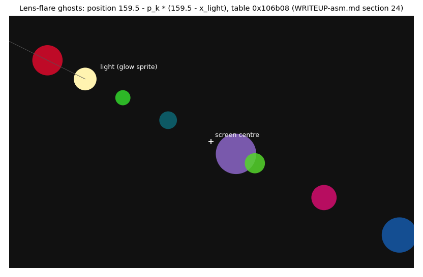
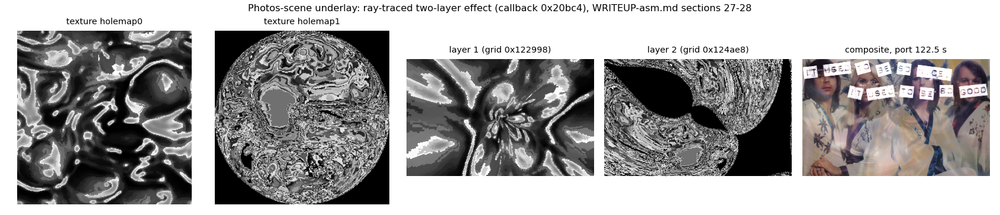
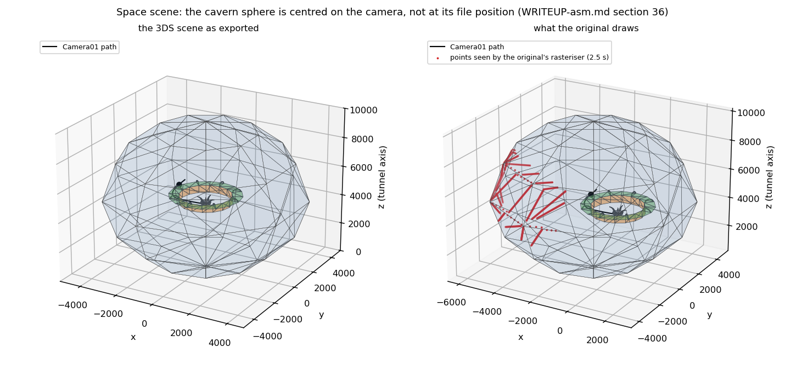
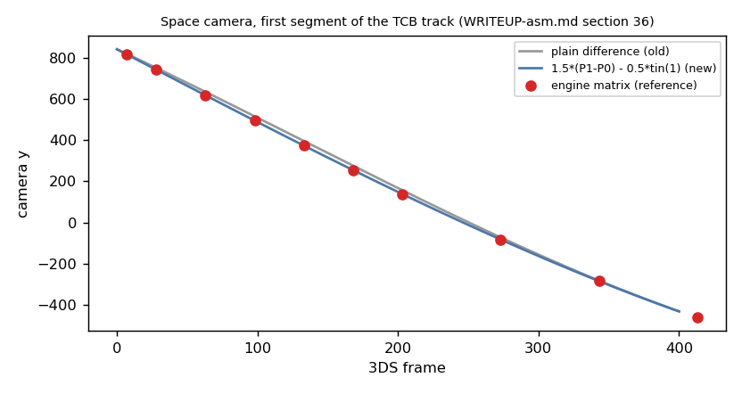
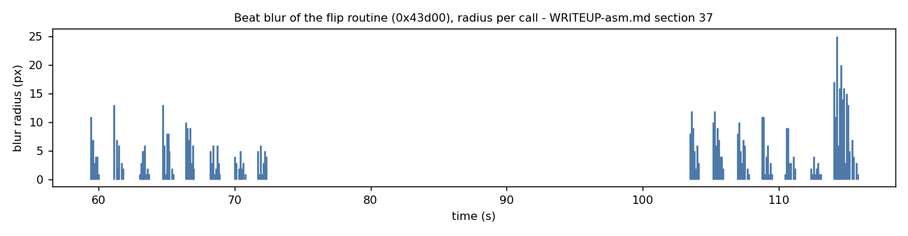

# HYPERVENTILATION - asm snippets

All listings come from the unpacked `HYPER.EXE` (`re/mem_clean.bin`, linear == file offset; reproduce with `python3 re/ds.py ADDR N`).
Code is Watcom C++ 32-bit (flat, PMODE/W). Addresses are the real ones; the immediates `0x12345678` are placeholders that the demo
patches at run time (self-modifying code, see snippet 3).

## 1. The inner loop of the textured, Z-buffered, per-channel-lit mapper (0x5a574)

```
5a574  shr ecx, 6                        ; ecx = interpolated 1/z (fixed point) -> 16-bit depth
5a577  mov [0x21bdc4], ebx               ; spill u (16.16)
5a57d  cmp cx, [esi+ebp*2]               ; 16-bit Z-buffer test, esi = zbuffer row, ebp = -pixels (counts up to 0)
5a581  mov [0x21bdc8], edx               ; spill v (16.16)
5a587  jae 0x5a603                       ; hidden -> skip the whole pixel
5a589  shr ebx, 16                       ; u integer part
5a58c  and edx, 0xff0000                 ; v integer part, already *65536 ...
5a592  shr edx, 8                        ; ... -> v*256 : textures are hard-wired 256 texels wide
5a595  and ebx, 0x12345678               ; u mask   (patched with the texture size - 1)
5a59b  mov [0x21bc90], eax               ; spill the light accumulator
5a5a0  xor eax, eax
5a5a2  mov al, [ebx+edx+0x12345678]      ; texel (8-bit paletted); displacement = texture base (patched)
5a5a9  mov dh, [0x21bc8a]                ; dh = red   light level (Gouraud, one byte per channel)
5a5af  mov edi, [0x21bdd0]               ; destination row
5a5b5  mov bh, [0x21bc92]                ; bh = blue  light level
5a5bb  mov dl, [eax*4+0x12345678]        ; palette R  (palette apparently stored as interleaved byte tables - inferred from the 4-byte stride)
5a5c2  mov bl, [eax*4+0x12345678]        ; palette B
5a5c9  mov [esi+ebp*2], cx               ; Z-buffer write
5a5cd  mov ch, [edx+0x149a18]            ; shade LUT: [light<<8 | colour] -> lit colour (no multiply)
5a5d3  mov dl, [eax*4+0x12345678]        ; palette G
5a5da  shl ecx, 8
5a5dd  mov dh, [0x21bc8e]                ; green light level
5a5e3  mov cl, [ebx+0x149a18]
5a5e9  mov eax, [0x21bc90]
5a5ee  mov ebx, [0x21bdc4]
5a5f4  mov ch, [edx+0x149a18]
5a5fa  mov edx, [0x21bdc8]
5a600  mov [edi+ebp*4], ecx              ; one 32-bit pixel, 3 table lookups, 0 multiplies
5a603  mov esi,[0x21bc88] ... add esi,0x12345678 ... add edi,0x12345678   ; step the three light levels / z (patched constants)
5a64a  add ebx, esi                      ; u += du
5a64c  add edx, edi                      ; v += dv
5a655  jne 0x5a574                       ; loop, max 16 pixels
```

What is clever: the 8-bit palette is pre-split into byte tables and the lighting multiply is a 64 KB LUT at `0x149a18`
(`[row*256+colour] = floor(colour*row/64)`, row = integer part of the interpolated light, 0..63; measured by dumping the table from the emulator), so Gouraud shading in true colour costs three dependent byte loads. Depth is 16 bit and compared with the
same register that is used as `cx` for the store, so test+write share one instruction pair. The loop counter doubles as the
destination index (`[edi+ebp*4]` with `ebp` negative and incrementing to zero).

## 2. 16-pixel perspective sub-spans with the FPU divide hidden behind integer work (0x5a2c8..0x5a34b)

```
5a2c8  fild dword ptr [0x21bdc4]         ; x offset of the span start
5a2ce  fld  dword ptr [0x21bd38]
5a2d4  fld  qword ptr [0x10b920]
5a2da  fmulp st(2)
...                                      ; u/z, v/z, 1/z evaluated at the span start (plane equations)
5a308  fld1
5a30a  fdiv st(3)                        ; 1/(1/z) = z : ONE divide per span, issued here ...
5a30c  shr ecx, 0x10                     ; ... while the integer unit continues with span set-up
5a315  fld st(2) / fld st(2) / fmul st(2) ...
5a321  fistp dword ptr [0x21bd74]        ; u, v of the span start as integers
5a327  fistp dword ptr [0x21bd78]
5a347  fld1
5a349  fdiv st(3)                        ; second divide (span end) overlaps the next integer block
```
The affine inner loop of snippet 1 is entered with at most 16 pixels per call (`cmp ebp,0x10` at 0x5a408): the classic
"perspective every 16 pixels" scheme. After the span the four `fstp [0x21bdc4]` at 0x5a459..0x5a46b drain the x87 stack.

## 3. Self-modifying code: patching the mapper before a polygon (0x5b8fc, 0x5bd6b)

```
5bd6b  mov [0x5bd5f], edi        ; patch the imm32 of  "add eax, IMM"  (0x5bd5e) = per-pixel z step
5bd71  mov [0x5bd23], ah         ; patch the shift/mask byte of the v extraction
5bd77  add ebx, ecx
5bd79  and eax, 0xff
5bd7e  mov [0x5bd2a], eax        ; patch the u mask imm32 (and ebx, 0x12345678 at 0x5bd28)
5bd83  mov [0x5bd3d], ebx        ; patch the texture-base displacement of  mov ecx,[ebx*4+0x12345678]
5bd89  mov ebx, 0x5bd07          ; ebx = entry of this mapper variant (32-bit texel loop)
5bd8e  jmp 0x5b8fc

5b8fc  mov ecx, 0x5bb03          ; end of the common dispatch stub
5b901  sub ebx, ecx              ; ebx = variant - stub_end  = a rel32 displacement
5b903  mov [0x5baff], ebx        ; patch the rel32 of the jmp at 0x5bafe: the polygon driver now "jumps" into the variant
```
Every texture-mapper variant (8-bit palette, 32-bit texels, env/bump) has its own constants patched in place and the shared
polygon walker (0x5a25d... 0x5b949, same structure twice) reaches the right inner loop through a patched jump displacement rather than a
function pointer or a branch. The code object `0x1b000-0x70000` therefore has to be writable and the immediates are `0x12345678`
in the on-disk image. Beware when snapshotting: take the image **before** the demo has run (see `re/unpack_clean.py`).

## 4. The 70 Hz timer callback (0x1de94) - the whole demo clock

```
1de94  push esi
1de95  mov eax,[0x10eb9c] ; inc dword [0x10eb9c]      ; global tick (3DS keyframe time!)
1dea0  mov eax,[0x10eba0] ; inc dword [0x10eba0]      ; frame-pacing tick
1deab  mov eax,[0x10eba4] ; inc dword [0x10eba4]      ; scene-local tick
1deb6  mov esi,[0x10eb60]  ...  call dword ptr [edx+0x84]   ; raster object's per-tick virtual
1dee1  call dword ptr [0x10ebb4]                       ; optional user hook
```
MIDAS calls it from its timer interrupt (`MIDASsetTimerCallbacks` at 0x1d436). Three counters because three consumers reset
independently; 3DS keyframes are evaluated directly at `[0x10eb9c]`, i.e. **one 3DS frame = one 70 Hz tick** (verified: the camera object holds the
position of keyframe time 693 at t = 10.0 s). This is why a port can make every frame a pure function of t.

## 5. The main loop: wait for a tick, derive dt, run the script (0x1d56a..0x1d5eb)

```
1d56a  cmp edi, [0x10eba0]        ; spin until the ISR advanced the tick counter
1d570  je 0x1d56a
1d572  mov eax,[0x10eba0] ; sub eax, edi ; mov [0x149948], eax   ; integer dt (ticks)
1d588  fild dword ptr [ebp-0x24]
1d58b  fmul qword ptr [0x10124c]  ; * 1/70 (0.0142857...)
1d591  fstp dword ptr [0x149944]  ; float dt in seconds, used by all particle/fade code
1d5b1  call dword ptr [0x10ebb8]  ; current scene's render callback (or the default one at 0x1d904)
1d5b7  mov eax,[0x10eb78] ; shl eax,6 ; add edx,[0x10eb80]       ; position = order*64 + row from MIDASgetPlayStatus
1d5e7  cmp edx, ebx ; jg 0x1d63f ; ... jmp [edx*4+0x1d024]       ; fire every script record whose order*64+row has been reached
```
The *music* drives the script (order,row), the *timer* drives animation. A frame can therefore fire several events.

## 6. The script is a table of 28-byte records (0x104aa0) and a jump table

```
record: { order, row, type, func, a, b, c }     e.g. 17 16 type=1 func=0x1e210 a=64   (a beat "pulse")
                                                      5  0 type=3 func=0x222c4 a=13 b=14 c=-20
1d5fa  cmp edx, 3 ; ja 0x1d95f                   ; 0x1d95f = "error in script!"
1d603  jmp dword ptr [edx*4+0x1d024]             ; type 0: f() 1: f(a) 2: f(a,b) 3: f(a,b,c)
222d1  dec ecx ; cmp ecx, 0xc ; ja 0x226a9 ; jmp dword ptr [ecx*4+0x22290]   ; 0x222c4: sprite/fader command switch (13 cases)
```
The 168 records (decoded in `web/assets/script.json`, tool `tools/script_dump.py`) are the whole direction of the demo: scene start/stop
functions (type 0), beat pulses (type 1) and sprite commands: 1 = start sprite, 2 = stop, 4 = fade in, 5 = fade out,
6 = fade to colour, 7 = flash colour, 8 = cancel.

## 7. x87 precision control used as an optimisation (0x1d10f, 0x20cee)

```
1d10f  fnstcw word ptr [esp]
1d112  and word ptr [esp], 0xfcff      ; PC = 00 -> 24-bit mantissa (single precision) for the whole demo
1d118  fldcw word ptr [esp]
...
20cee  fnstcw [esp] ; or word ptr [esp], 0x300 ; fldcw [esp]     ; 0x20cec: precision back to 64-bit for the matrix code
```
On a Pentium `fdiv` is ~19 cycles at 24-bit precision vs ~39 at 64-bit; the demo runs the rasteriser in single precision and switches back to extended only
around the 3D matrix concatenation at 0x202a4 (a matrix product written out as straight-line `fld/fmul/fxch` code).

## 8. Struct-by-value copy and 4x3 matrix product (0x202cd..0x20351)

```
202cd  mov eax,[edx+8]   ; mov [ebp-0x1f0],eax
202d6  mov eax,[edx+0x14]; mov [ebp-0x1ec],eax     ; the 3x4 camera/object matrix is transposed while it is copied into the frame
...
20351  fld dword ptr [esi]  ; fmul dword ptr [eax] ; fld [esi+4] ; fmul [eax+4] ; fld [esi+0xc] ; fmul [eax] ...
```
(the interleaved loads show the Watcom scheduler pairing `fld` with `fmul` to keep the Pentium FPU pipeline busy).

## 9. Why the shade LUT and 16-bit Z? Notes on the data side
* Textures are 8-bit PNG decoded once (zlib `inflate 1.0.4` is linked in). The `[eax*4+table]` stride of 4 suggests per-channel byte tables per palette entry (inference, not fully traced).
* The Z-buffer is 16 bit wide (`[esi+ebp*2]`), the frame buffer 32 bit (`[edi+ebp*4]`) in the 320x240x32 mode; 15/16/24 bit modes use other variants of the same loops.
* The DOS/PMODE/W details: the extender's `lsl` of DS is used as the initial heap break (0x52d1e) - an emulator must give a sensible DS limit.


## 10. The per-vertex lighter: smooth-step fall-off and a table-driven 1/sqrt (0x4672b..0x46a06, called through 0x463ec)

Everything the port needed to light the 3DS scenes like the original is in one 600-byte function. For each lit face it lights the three vertices that have not been lit this frame
(vertex flag bit 2 marks them), looping over the object's light list (a linked list at `[scene+0x16c]`, linked through `[light+0x9c]`):

```
46766  mov eax,[esi+0x8c] / fld [0x103664] (=2.0) / fadd [eax+0xa4] ... fstp [vtx+0x30]   ; colour = scene ambient (+2.0) per channel
467a7  fld [light+0xac] / fsub [vtx+4] ...                      ; D = light position - vertex position
467ce  fld D.x / fmul [vtx+0x40] ... faddp ...                  ; dot = D . N   (vertex normal at +0x40)
467eb  fldz / fcomp dot / jb 0x468c1                            ; light is behind the surface: next light
468c1  D.x^2 + D.y^2 + D.z^2 -> d2 ; fcomp [light+0xd4] / ja next   ; d2 > outer^2: out of range
468ea  fcomp [light+0xd0] / jbe 469a4                           ; d2 <= inner^2: factor 1.0
468fd  t = (outer2 - d2) / (outer2 - inner2)                    ; fld [d4] / fsub [d0] / fld [d4] / fsub d2 / fdivrp
4690f  s = (3.0 - 2.0*t) * t * t                                ; fmul [0x10366c]=2.0 / fsubr [0x10367c]=3.0 / fmul st(0) / fmulp : smooth-step
46941  eax = 2*bits(d2) - 0x7f000000 ; and eax,0xfe000000 ; neg ; sar eax,2 ; add eax,0x3f800000   ; fast 1/sqrt, step 1: exponent
4695e  ebx = (bits(d2) & 0xfff000) >> 12 ; add eax,[ebx*4+0x145140] ; and eax,0x7fffffff            ; step 2: 4096-entry mantissa correction
46973  fmul dword [esp+0x30]  ...  colour += s * mult * dot * (1/|D|) * light.rgb                      ; cos(angle) = dot/|D|
```

Three things are worth stealing:

* **The fall-off is `3t^2 - 2t^3` between an inner and an outer range**, both stored *squared* (`[light+0xd0]`, `[light+0xd4]`: the constructor 0x45c78 does `fld range / fmul st(0) / fstp`), so
  no square root is needed for the range test; 3DS's inner/outer range chunks (0x4659/0x465A) map straight to it.
* **1/sqrt(d2) is done with integer arithmetic on the float's bit pattern**: `2*bits - 0x7f000000` halves and negates the exponent (the `and 0xfe000000` clears the lost bit, `neg`+`sar 2` produce `-(e/2)`),
  and the top 12 bits of the mantissa (which include the exponent's parity bit) index a 4096-entry table of corrections (`0x145140`) that I dumped: the result is within 2.4e-4 of the true value.
  It replaces a `fsqrt`+`fdiv` (about 70 cycles on a Pentium) with ~10 cycles of integer code.
* The light's contribution is *per channel* and the sum is clamped at **250.0** (`cmp ... 0x437a0000`), then multiplied by **16384.0** (`[0x103674]`): the vertex colour is a float that is already a 16.16 fixed
  number whose integer part is `light/4`; the rasteriser's per-channel accumulators (snippet 1) walk that value and index the shade LUT with its integer part. Net effect: `lit = texel * floor(min(L,250)/4) / 64`.
  Fog is the same code: if `[0x1499e8]` is set the three channels are also multiplied by `clamp(1 - z*[0x1499ec], 0, 1)` (z = camera depth) just before the 16.16 conversion.

The function is also instructive by what it does *not* have: no spot lights, no specular, no per-pixel work, no attenuation curve other than the smooth-step. A scene with 24 lights is cheap because each object keeps
a short list (0x462c8 transforms every light into the object's space and keeps those with `distance - bounding_radius < outer range`, with a square root from the same bit trick).


## 11. The "tunnel" is a 41x26 distortion grid, not a polar tunnel (0x23350, constants dumped from the emulator)

The lava and swirl "tunnels" (30-44 s, 128-144 s) use no polar mapping at all. Every frame the code builds a grid of 41x26 vertices (one every 8 pixels) and hands the grid to the textured-quad renderer:

```
2335d  fild [0x10eb9c] (scene tick) / fadd phaseX[k] / fld freqX[k] / fmul pi / fmulp / fcos / fmul 150.0 / fadd 160.0 / fstp cx[k]    ; 3 attractors, cosines of the tick
23422  dx = px - cx ; dy = py - cy ; r2 = dx*dx + dy*dy + 500.0 ; inv = 1/r2                      ; fld1 / fdiv st(3)
2342e  U += dx*str[k]*inv ; V += dy*str[k]*inv                                                  ; str = +6.7e8, -3.4e8, +1.7e8  (a 1/r "lens")
2344c  f = (r2 + 5000.0) * (1/15000) ; if (f < 1.0) shade *= f                                  ; dark core around every attractor
2346d  u = (524288*i + U) << 8 ; v = (524288*j + V) << 8 ; shade_fixed = shade_float << 8       ; 524288 = 8 px in 16.16
```

Each vertex therefore carries a texture coordinate equal to its own pixel position plus `str*(dx,dy)/(r^2+500)/65536` texels, i.e. the texture is pushed radially around three moving points: a 1/r lens that looks like
a tunnel with three vanishing points, for 41*26*3 = 3200 divisions per frame instead of 64000 pixel lookups through a polar table. The shade (0..63.99, initialised from the float constant `0x4a7ffffc`) darkens the lens cores
through the shade LUT of snippet 1. Everything is derived from one integer, the scene tick `[0x10eb9c]`, which the scene constructor resets to 0 (reset times measured: 30.1, 44.3, 58.2, 72.4, 83.1, 100.7, 114.9, 128.6, 132.9, 136.9,
140.0, 143.8, 147.3, 157.9, 172.0 s: the swirl is four sub-scenes with their own textures). The port reproduces it with a bilinear fill of each 8x8 cell and matches the original's structure closely (frame error at 33 s: 8/255);
the original's output is darker and more saturated than texture x shade (histogram match: `out ~ c^1.45` per channel), which the port applies as an empirical gamma.


## 12. Metaballs: field sampler and marching cubes (0x24698, 0x3697c, 0x377fc)

The sampler (a callback stored in the iso object at `[obj+0x188]`) advances five balls and fills a 17^3 float grid. Each ball keeps three 10-bit phases (`[0x13192c+4i]`, `[0x131954+4i]`, `[0x13197c+4i]`):
```
24706  mov eax,[ecx+0x106568]     ; speed A
2470c  imul eax,edx              ; * dt ([0x149948] = ticks since last frame)
24711  add eax,[ecx+0x13192c]
24717  and eax,esi              ; esi = 0x3ff
```
then `pos = 0.4*ext*(sin(a1*pi/512), cos(a2*pi/512), sin(a3*pi/512))` (fsin/fcos at 0x247a4/0x247bd). Per grid point the loop at 0x2494c evaluates, for each ball with `r2 < 0.999*R2`,
`1 - a*r2^3 + b*r2^2 - c*r2` with `a=4/(9R2^3)`, `b=17/(9R2^2)`, `c=22/(9R2)` (the constants 9, 4, 17, 22 live at 0x101c0d..0x101c25): the classic Wyvill/Brown/Wyvill polynomial in the squared distance.

The mesher 0x3697c walks the 16^3 cells, builds an 8-bit corner mask (`corner < iso` -> bit k, offsets 289,290,1,0,306,307,18,17 in grid units), looks up the 12-bit edge mask at `0x108d20` (dwords) and
the triangle list at `0x109120` (16 bytes per case, 0xff terminated), and creates edge vertices on demand (cache flags per grid point, so vertices are shared) with the routine at 0x377fc:
`t=(iso-f0)/(f1-f0); p=p0+t*(p1-p0)`, normal = lerp of the forward-difference gradients scaled by `[obj+0x1d0]`(=1/90), renormalised with the table-driven 1/sqrt, `u=4+4*atan2(z,x)/pi`
(`fpatan` at 0x34d8c). Faces are 0x38-byte records pointing at the three vertices (reversed order).


## 13. The texture + environment (+bump) mappers: they average, they do not add (0x5e77c / 0x5ec1c, 0x5f5b6)

The perspective-correct span mappers (a 16-pixel subdivision loop, inner loop patched in place) come in variants. The texture+environment one (inner loop 0x5ec1c..0x5ecdc) fetches *two* 8-bit texels
and averages their palette colours:
```
5ec5a  mov al,[eax+ebx+tex]        ; texture index at (u,v)
5ec63  mov bl,[ecx+edx+env]        ; environment index at (eu,ev)
5ec7b  mov eax,[eax*4+pal_tex]     ; 32-bit palette colours (already lit)
5ec82  mov ebx,[ebx*4+pal_env]
5ec89  and eax,0xfefefe ; and ebx,0xfefefe
5ec94  add ebx,eax ; shr ebx,1     ; (tex+env)/2
```
with a 16-bit z test (`cmp si,[edi+ebp*2]`) in front. The bump variant (0x5f5b6) uses the same texel index for the texture and for a 16-bit *bump word table* `[idx*2]`; its two bytes
are added to the interpolated environment coordinates (`add al,dl / add ah,dh`) before the environment fetch, then the same average. The bump table is built once by the bitmap loader 0x4a208:
`dU = clamp(h(x-1,y)-h(x+1,y), -128, 127)`, `dV = clamp(h(x,y-1)-h(x,y+1), -128, 127)` (wrapping neighbours), i.e. the offsets are in environment-map texels.
`engine.js` now does the same (the old port added the environment colour and scaled a forward difference by 0.02).


## 14. Second iso scene: sampler 0x23ac0, particle emitter 0x23d48, particle blit 0x53563

```
23af7  fld [ebx+0x1064a0]      ; per-ball speed (float, per frame)
23afd  fadd [ecx+0x131790]     ; y += speed
23b09  cmp [ecx+0x131790],0x447a0000 ; >= 1000.0 -> wrap to -1000 and re-roll x,z with rand()%400
```
The shade table has a second half: rows 0..63 are `c*r/64`, rows 64..127 are `min(255, c*(r-64)/32)` (dumped from 0x149a18). The additive particle blit (0x5360f..0x5365e) reads
`row = tint>>2` per channel, adds `T[64+row][texel]` to the destination with saturation, and skips texel 0.
The particle update (0x2406c): `v += (g+a)*dt; pos += v*dt + (g+a)*dt^2/2; size *= 1.02^dt` (g = [0x149904] = (0,-1,0), the damping at [0x1498f4] is 0).


## 15. Two-layer swirl scene (132.74-136.71 s): grid 0x21c24, cell filler 0x34db4, blend 0x351ef - pixel-exact

Every number below was verified against the emulator: the 41x26 vertex arrays at 0x127db4/0x129f04/0x126d08 (tick 147), the two 8-bit layer surfaces and the final 32-bit buffer (0 differing pixels).
* Vertex (x,y = cell offset from the screen centre +0.5, t = scene tick): `ang = atan2(x,y)` (the helper 0x34d81 is `fxch; fpatan`), `D = 1.5 cos(2 ang + .04 t) + sin(3 ang + .1 t) + 2.5`; layer 1 coordinates
  `5 (x c - y s) D`, `5 (x s + y c) D` with `c,s = cos/sin(.02 t)`; layer 2 `6 cos(.03 t + 3 ang) r` and `3 (4 r sin(.3 r + .07 t) + .01 t D)` where **r is the table-driven sqrt** (0x21d80..0x21da6: `2*bits - 0x7f000000 >> 2`, table 0x141140: the same trick as the lighter's 1/sqrt but without the `neg`); shade `clamp(1..63, (.2(sin(.03t+.1x)+1) + .2(cos(.07t+.2y)+1)) (20(5-D)+40))`.
  Stored as `round(v*65536)<<8` (so the texture coordinate is the byte at bits 24..31), the shade array is written one element late (`add ebx,4` before the store: element 0 overlaps the pointer variable 0x126d08).
* Cell filler 0x34db4: per 8x8 cell the four corner values are interpolated in int32: `dL = (BL-TL)>>3`, per scanline k = 1..8 `L += dL, R += dR`, `step = (R-L)>>19`, start `L>>>16`, texel index `((v>>8)&255)<<8 | (u>>8)&255`.
* Blend 0x351ef: the shade array is interpolated the same way (row = bits 8..15 of the 16-bit accumulator), `pixel = T1[row][texel1] + T2[row][texel2]` with `T[r][i] = (palette*r)>>7` per channel (two halved layers added without saturation).

## 16. Asset note: PNG colour management
60 of the 95 PNG assets carry gAMA+cHRM chunks, so browsers colour-converted their palettes while the original uses them raw. The chunks are stripped from the assets (this alone took the mean error from 30.4 to 27.7 and made the empirical tunnel gamma unnecessary).

## 17. Halftone scene (136.9-139.8 s): init 0x25c9c, render 0x25d80, mask table 0x25b60 - pixel-exact background

Same 41x26 vertex grid and cell filler (0x34db4) as section 15, with two layers (`mefis` = layer A at [0x137de4], `forcemao` = layer B at [0x137de8]; note the assignment is the reverse of the init order one would guess). Per vertex (x in -20..20, y in -13..12, t = scene tick, r = sqrt(x^2+y^2), P = r*r):

    A1 = x*(2 sin(.00034 P)+10)          B1 = y*(cos(.0013 P)+5)
    th = .6 sin(.7 r+.022 t) + .5 sin(.3 r+.116 t)
    U1 = cos(th) A1 - sin(th) B1 - 256 cos(.006 t)      V1 = cos(th) (A1 - B1) - 256 sin(.007 t)   (sic: cos twice, the original's bug)
    A2 = x*(sin(.001 r x)+6)             B2 = y*(2 cos(.002 r y)+14)
    ph = .3 sin(.3 r+.003 t) + .64 sin(.3 r+.004 t) + .07 t
    U2 = cos(ph) A2 + sin(ph) B2 + 256 sin(.003 t)      V2 = -sin(ph) A2 + cos(ph) B2 + 256 sin(.005 t)

stored as trunc(v*65536)<<8 (int32 wrap). **The x87 is in single precision with chop rounding** (control word PC=24 bits, RC=truncate): every + - * / sqrt result is truncated to a float32, sin/cos are not. Emulating that (`c()` in `scenes.js`) makes 92% of the vertices bit-exact, the rest differ by under 1e-4 texel; with round-to-nearest doubles nearly all of them were off by a few 1/65536.

Blending is per 8x8 block: v = trunc(63 L/(a^2+b^2+L)) & 63 with L = 15000 cos(.034 t+3.0159)+17000, a = 100 cos(.11 t)+x-160, b = 90 sin(.093 t)+y-100 (x,y = the block's top-left pixel). The table at [0x137df0] holds 32 discs of radius (32-e)*.17 (distance from (4,4) to the pixel centre) followed by their 32 inverses; entry v selects, per pixel, layer A's palette (0) or layer B's (1). Verified against the emulator at 138.0 s: layers and mask table 100%, composite exact except under the lyric sprites.

## 18. Sprite anchors (0x22145): -1 / -2 are edges, not "centred"

Sprite records (36 bytes at 0x105dfc, built by script command 1 at 0x222c4) hold a centre position as floats; at start 0x22136-0x22252 compares the stored x / y with the doubles -1.0 and -2.0 (0xbff00000 / 0xc0000000) and replaces them: x = -1 -> w/2 (left-aligned), x = -2 -> 320 - w/2 (right-aligned), y = -1 -> h/2 (top-aligned), y = -2 -> 200 - h/2 (bottom-aligned) (constants 320.0 at 0x10177d and 200.0 at 0x101785). The lyric strips (`thelove.png` 320x130 at y=-1 etc.) therefore sit at the top or bottom of the 320x200 viewport instead of being centred; fixing this took the mean error from 24.7 to 23.7/255.

Open: in the reference run the strips are additive white boxes in some scenes (tunnels, photos at 122-127 s, S.O.S.) but dark boxes (`dst*(1-img)`: black where the strip is white, background kept where the letters are) at 117 s and 147-157 s; the sprite records are identical, so the mode is set at run time (probably through the fader state at 0x12c060-0x12c08c / [0x12c068] = 6,7 handled at 0x22a7f-0x22bf4). Not ported yet.

## 19. Sprite blend modes (v4)

The sprite blitter (`0x42738`, reached through the engine object's vtable +0x64) picks its inner loop from the record's `v3` (2 = alpha/additive family) and `v4`:

| v4 | blitter | effect |
|----|---------|--------|
| 0 | `0x53d6c` | palette additive: `dst += pal[texel]·alpha` |
| 4 | `0x53ecc` | grey additive: `dst += t·alpha` (white strips) |
| 12 (bit 8 set) | `0x53ff8` | subtractive: `dst -= t·alpha`, clamped at 0 (the black lyric boxes at 115–122 s and 143–157 s) |

`t` is `0x149a18[alpha<<8 | texel]`. Texel 0 is skipped. The table dump from the emulator shows that the image/position columns of the sprite table sit one record behind the kind/alpha/v4 columns: script event 21 draws `itused.png` (320x77) with record 21's v4 = 4. `demo.js` takes the blend class from the next JSON record (`nx`). Mean error 23.7 → 21.8/255.

Photo sprites use the same offset: the photo at 117.5 s is blended by `0x35e4c` with alpha 0x8c (0.55, record 17's alpha), not drawn opaque. Sprite fades (commands 4/5) start about 0.19 s (2 frames) after the script event (event at 122.136 s, first alpha step at 122.33 s). Mean error 21.8 → 20.5/255.

Fader (`0x22a7f`): mode 6 = fade *to* the colour (source weight 1−t/dur), mode 7 = flash *from* the colour (source weight t/dur); the script commands 6/7 map to them as-is. A command takes effect about 0.2 s (two 7-tick frames) after its script time, and the frame rendered then lags the logged timer by a bit more; the port uses 0.26 s for fader commands and 0.19 s for sprite start/stop/fades. The portrait scene applies sprite 39's fade itself. Mean error 20.5 → 18.8/255.

## 20. Particle system (hallu, 72.4-93.7 s)

Callback `0x1e7d8` (hallu) sets the 3DS frame to `trunc(1.2 * tick)` (`[0x10eb9c]` is the scene tick; piikit's `0x1f45c` uses `tick` unchanged), then runs the particle stage `0x2ae88`.

- **Emitters** (`0x1e8e8`, one per light `particle00..02`, object list in `[obj+0x98]`, max 1000): every frame `n = trunc(dt_ticks * 1.0)` = 7 particles at the light's position. Per particle, in `rand()` order (`0x28182`: `s = s*0x41c64e6d + 0x3039; (s>>16)&0x7fff`): three `q = (rand%1000)*0.4*0.002 - 0.4` give the colour `R = 100+128*q1`, `G = 40+128*q2`, `B = 25+128*q3` (chop, clamped; defaults in `[0x10ebd0..d8]`); three `rand%1000 * 0.01 - 5` the velocity; `(rand&0xffff)/65536 + 4.1` is the drag divisor `r` (stored with `1/r`); `rand%1000 * 0.005 + 3` the size. Life = 200 ticks.
- **Update** (`0x1ec24`), per particle, `dt = 0.1` (7 ticks): life -= 7, dead at <= 0; `v += g*dt` (g = `[0x149904]` = (0,-1,0)); `v += (vt - v)*0.01*(1/r)` (`[0x1498f4]` = 0.01, target `[0x1498f8..]` = 0); `p += v*dt; p += 0.5*dt*dt*g`; `size *= 1.02^dt` (`fyl2x`/`f2xm1`). Then it draws the particle at once (`0x32f10`), so the particles are drawn newest first, inside the update loop.
- **Draw** (`0x32f10`): view transform by the matrix at `0x149914` (3x3 + translation); the particle is skipped unless `1.5 <= z <= 514.9` and `z <= size*160`; screen `x = 159.5 + f*xv/z`, `y = 99.5 - f*yv/z` with `f = 160/tan(fov/2)` (203 for the hallu camera, FOV 76.36; the matrix rows are scaled by `1/tan(fov/2)`, y additionally by 1.6 and the aspect 0.625 cancels it). This is not the focal length the port's mesh renderer uses (128.7, calibrated empirically on meshes), square side `2*size*160/z`. Submitted as a descriptor with `v3 = 3` and colour bytes `trunc(c*life/200)` to the blitter `0x53563`: per channel `dst = min(255, dst + (texel*(c>>2))>>5)` (table at `0x14da18`), R from `+0x2e`, G from `+0x2d`, B from `+0x2c`.
- The reference run consumes 368 `rand()` calls per frame from one global stream (3 emitters use 168), so only the statistics can be reproduced; the port gives each emitter-frame its own stream.

Hallu2 (86.6-93.7 s) continues the same scene tick: it starts at about 1000 (`tick = 994 + 70*lt`), so the camera animation is at 3DS frame ~1200. The original world has y up (= 3DS z), so gravity is (0,0,-1) in the port's 3DS coordinates. Mean error 18.8 -> 18.0/255 (82.5: 33 -> 24, 87.5: 20 -> 11, 92.5: 13 -> 9).

Scene cameras were checked against the original by recovering the camera position from the engine matrix (`0x149914`: `pos = -R^-1 t`) at several times and scanning the 3DS cameras for the same position: hallu = `Camera01` at frame `trunc(1.2*tick)`; piikit (83.1-86.6 s) = `piikit2.3ds` `Camera01` at frame `tick` (tick = 70*(t-83.0)); piikit2 (93.7-100.7 s) = **`Camera03`** at frame `tick` (tick ~ 749 + 70*(t-93.7)), position error 0.0. The mesh renderer of these scenes also uses the particle projector's focal length `160/tan(fov/2)`. Mean error 18.0 -> 17.6/255 (97.5: 17 -> 4).

## 21. Swirl 1 (128.6-132.9 s, callback 0x254a8) and looped 3DS tracks

- The scene is a **2-attractor** warped grid (`0x2522c`, same 41x26 grid and cell filler `0x34db4` as the tunnel) on `fil.png`, then the `morph.3ds` object (camera/animation time = scene tick, `[0x10eb9c]`, 0 at 128.6 s; material DOOM + ENVPLANE reflection, no lights: drawn unlit) and the particle stage. Attractor k at tick `T` (globals `0x10660c..0x106640`; phases 1300/1030, frequencies 0.0212 pi / 0.0301 pi): centre `(40*cos((T+1300+o)*0.0212*pi)+160, 40*cos((T+1030+o)*0.0301*pi)+100)` with `o = 40, 20` for attractors 1, 2; strengths `cos((T+200)*0.02)*150*2^24-150` and `cos(T*0.03)*180*2^24-140` (float32). Per vertex `u = 524288*i + sum(dx*s/(r2+500))`, `v` likewise, shade `4194303 * prod((r2+700)/14000 if < 1)`. The values dumped from the emulator match to 0.003 texel (UV) and exactly (shade). The visible intensity is half that of the tunnel's (`shMax` 32 instead of 64, measured on lit pixels: gold/ours = 0.49).
- Coordinates are 8.24 fixed point in int32 and wrap at 256 texels; the cell filler interpolates the wrapped differences (shortest path), which the port reproduces.
- **Looped tracks.** A 3DS track whose flags word has `(flags & 3) == 3` is looped: `0x38fc0` takes the time modulo `last_frame+1`, and the first/last keys use the wrapped neighbours (`keys[n-2]` before the first, `keys[1]` after the last) in the TCB tangent. For the morph camera (keys at 0, 600, 1300 with `key[2] = key[0]`) this gives a zero tangent at frame 0 and reproduces the original's camera position to 0.1 unit at every sampled tick (the old one-sided end tangent was 25 units off at tick 63). Applied to all 3DS files (`s3ds.js`). Mean error 17.0 -> 16.7/255 (132.5: 32 -> 24, 157.5: 33 -> 30, 167.5: 15 -> 13; 147.5: 33 -> 35).

## 22. Camera clocks of the balls and tv scenes

- **tv (157.8-171.9 s)**: camera frame = scene tick (`[0x10eb9c]`, tick 322 at 162.5 s); with looped tracks (section 21) the recovered camera pose equals the 3DS camera at frame = tick to 0.000 at several ticks.
- **balls (143.8-157.8 s, callback `0x24f08`)**: the 3DS time is **music-synchronised**: `frame = trunc(([0x10eb78]*64 + [0x10eb80] - [0x106608]) * 12.5)`, i.e. the song position (order*64 + row) minus the position at the scene start (2495 = order 38, row 63) times 12.5 frames per row; the camera track wraps modulo 1201. Background `raita.png` is copied into the frame buffer first (0x3e800 bytes), then the scene is drawn, then the particle stage and the light flares. The port reads the position from `xm_times.json` (0.1 s earlier than the frame time). Mean error 16.7 -> 16.0/255 (147.5: 35 -> 23, 157.5: 30 -> 16).

Texel 0 is skipped by the palette-additive blitter, so a full-viewport kind-2 image with v4 = 0 (`skenenp2.png`, the coat over the lava tunnel at 36-44 s) leaves the scene visible through its black. The port now skips black texels for those sprites (37.5: 26 -> 7, 42.5: 29 -> 18). Mean 16.0 -> 15.2/255.

## 23. Space scene (0-30 s)

The camera is `Camera01` of `space2.3ds` at 3DS frame = scene tick, which lags the timeline by one 7-tick frame (tick 1568 at 22.5 s; the engine matrix gives the camera position to 0.006 units). The projection uses the same `160/tan(fov/2)` as the particles (the empirical 128.7 focal is gone). The static object `fd` at (0, -5, 4939) is not drawn by the original (the blue chevron shape it produces in the port is absent from the reference), so it is skipped. Mean 15.2 -> 14.9/255.

## 24. Lens flares (0x31180) and scene ticks



*Figure: the ten hexagon ghosts sit on the line through the screen centre (positions `p_k`, sizes and colour multipliers from the table at `0x106b08`).*


`0x31180` runs after the particle stage in space, room, hallu/piikit and balls. For each light with `[L+0xe8] != 0` (lights named `flash*`, the emitter lights with bit 4, hallu's glow lights): the light is projected like a particle (`x = 159.5 + f*xv/z`, `y = 99.5 - f*yv/z`, `f = 160/tan(fov/2)`), tested against the frustum (`0x44020`: near, far, |x'| <= z, |y'| <= z) and against the 16-bit depth buffer (`0x2b6a8`: visible if the stored depth, `z*[0x149968]>>6` units, is larger than the light's). Then, with `alpha = [L+0xf0]` scaled by the depth fade (`1 - 0.5*z*k` when the fog flag `0x1499e8` is set; `1 - ((z-near)*0.9/(far-near)+0.1)` when `[0x1498d4]` bit 4 is set, as in the room):
- bit 1 of `[L+0xe8]`: a glow sprite (`glow.png`, blitter `0x53563`, colour bytes `trunc(col*alpha)`), side `2*[L+0xd8]*160/z` (`[L+0xd8]` is the light's inner range), skipped if > 512;
- engine flag 8 (`[eng+0x2c]`) and `s = side*[L+0xe0]*alpha > 10`: ten hexagons of `lens.png`, blitter `0x536a0` (flat colour added wherever the texel is not 0). Hexagon `k` sits at `159.5 - p_k*(159.5 - sx)`, `99.5 - p_k*(99.5 - sy)`, has side `s_k` and colour `trunc(col/255 * q * m_k)`, with `q = (1 - (dx^2+dy^2)/(2*160^2)) * min(1, (s-10)/10)`. The ten rows (`m_r, m_g, m_b, s_k, p_k`, table `0x106b08`, stride 0x14) are in `demo.js` (`GHOSTS`);
- engine flag 0x10 (the white screen glare, `vtable+0x78`) is never set.

The port reads the per-call light list (colour, range, alpha, position, plus the frustum/depth-test outcome, because its own depth buffer differs slightly from the original's) from `assets/flares.json`, dumped from the emulator, and draws the record of the first frame at or after `t`. The sprite count per frame now matches the original in space, the room (46-51 s) and hallu/piikit.

Scene ticks recorded with the flares: the room's 3DS frame is `trunc(1.2*tick)` like hallu's (it was 1.0*tick); hallu's tick is `70*(t - 72.5)`, piikit's `70*(t - 83.1)`, hallu2 `987 + 70*lt`, piikit2 `742 + 70*lt` (each one frame lower than the earlier fits). Mean 14.9 -> 14.7/255.

## 25. Exact light lists and the loader's stale texture coordinates

**Lights.** The lighter (`0x463ec`) walks the object's light list (`[ctx+0x16c]`, linked through `[L+0x9c]`) and reads colour `+0xb8..c0`, world position `+0x2c..34` (the lighter's `+0xac` is the same point in object space), squared inner/outer range `+0xd0/+0xd4` and multiplier `+0xe0` (the same field as the flare size, so the emitter lights count x5). The ranges are animated by the demo's scripts; instead of the old `lightanim.json` samples keyed by colour and rank (the room's four identical blue lights were mixed up) the port now reads every frame's list straight from the emulator (`assets/lights.json`, union of the lists seen by all objects in the frame; the frame is the first record at or after `t`, like the flares).

**Texture coordinates.** The 3DS loader (`0x2cbd3`, chunk 0x4140 handler `0x2ce51`) stores the coordinates in two static arrays (`0x1af8e0` u, `0x1bf8e0` -v) and the object builder (`0x2d261`, `0x2d655`) copies `array[i]` into vertex `i` (`+0x28/+0x2c`) for every object, whether or not the object had a 0x4140 chunk. An object without coordinates (the room's `pylvs01/03`, `jalusta*`, `peili`, `hissi*`) therefore gets the previous object's coordinates (and, beyond its count, older ones). `s3ds.js` reproduces this (`staleUV`); the dump of `peili`'s vertices from the emulator (u = -6.98 .. 0.99 by vertex index, v = 0) matches. The lift-shaft box at 47.5 s is `peili`, and the original draws it with a 2x2 lattice while the port's rendering of those degenerate coordinates gives vertical stripes, so `peili` is still treated differently somewhere (probably a mirror/env pass) that is not reversed yet. Mean 14.68 -> 14.69/255 (the exact lights alone: 14.65).

## 26. Render tick = frame-boundary tick - 7

The scene tick `[0x10eb9c]` read at a frame boundary (what the reference harness logs) is `70 * (t - scene start)`, but the frame shown at that boundary was rendered one 7-tick frame earlier, so every tick-driven effect uses `tick - 7` (measured: space camera, room, hallu, piikit, flares; confirmed with boundary ticks 168/518/868 at 32.5/37.5/42.5 s for the lava tunnel, 112 at 134.5 for swirl 2, 42 at 137.5 for the force scene, 175 at 142.5 for the last tunnel, 126/476/826 for the metaballs). Applying it to the lava tunnel, swirl 2, the force scene, the last tunnel sub-scene and the metaballs: 32.5 s 17 -> 3, 137.5 s 30 -> 17, 42.5 s 18 -> 14. Mean 14.7 -> 13.9/255. (The blob scene's object frame and the flesh scene's frame counter do not change measurably.)

## 27. The photos scene (114.9-128.6 s) hides a ray-traced two-layer effect (0x20bc4) - not ported yet



*Figure: the two 256x256 textures, the two layers produced by the cell filler from the ray-traced grids (emulator dump at 122.4 s) and the port's composite at 122.5 s.*


Every frame of the photos scene calls the callback at `0x20bc4` before the photo sprites are drawn (the cell filler `0x34db4` runs twice per frame, `0x35e4c` blends the photos). It is the same effect the last swirl sub-scene (140-143.8 s) is made of, and it is why the reference frames around 122 s show a smeared, whitish copy of the photo (error 27 at 122.5 s):

- `0x20bc4`: time from the scene tick (`[0x10eb9c]`) drives a rotation angle (`[0x1218d8]`, 10-bit) and an offset (`[0x105d7c]`, `[0x105d80]`), builds a camera/object matrix (`0x322dc`), and calls the grid builder `0x202a4`.
- `0x202a4` is a small ray tracer: for each of the 41x26 grid vertices it interpolates a ray between the transformed corners of the view box, solves a quartic (`0x355c4`, with `pow` in `0x39eca`, and a second quadratic `0x35548`) for the nearest positive root, converts the hit point to spherical coordinates with `fpatan` (`0x34d81`) and stores two 8.24-ish grids (`0x122998`, `0x124ae8`: `u = round(...)<<9`, `v = round(...)<<8`/`<<9`) and a per-vertex shade (`0x1218f0`). The two textures are 256x256 8-bit (`holemap0/1`); the filled layers are two 320x200 8-bit pages.
- `0x34d24 -> 0x351ef` composites the layers: per pixel `LUT0[(shade<<8)|layer1] + LUT1[(shade<<8)|layer2]` (palette-times-shade tables at `[0x21b314 + 4*k]`, k = 0 and 1 pushed by the caller), with the shade interpolated bilinearly per 8x8 cell.

Not reversed yet: the quartic solver and its constants (`0x101560..0x1015f8`, `0x102b68..0x102bb0`), the table contents of `[0x21b314]`, and the order of the photo sprites over this underlay.

## 28. Porting the ray-traced effect by transpiling the original (tools/x2js.py, web/js/holefx.js)

The grid builder is too long and numerically delicate (a quartic solved through a cubic and quadratics, `pow`, `fpatan`) to transcribe by hand, so `tools/x2js.py` turns the disassembly of self-contained functions into JavaScript instruction by instruction: integer registers and flags, the x87 stack (with `fcom`/`fnstsw`/`sahf` flag plumbing), memory through a sparse image. `holefx.js` contains `0x202a4` (grid builder), `0x355c4`/`0x357f8`/`0x35548` (cubic, quartic, quadratic solvers) and `0x20bc4` (per-frame callback up to the filler calls) with `0x322dc`/`0x30244` (object matrix). Only the C library is replaced natively: `fpatan` (`0x34d81`), `pow` (`0x39eca`).

- State: one callback call per 7-tick frame (tick = 7n, the first at 115.0 s); the rotation angle `[0x1218d8]`, the float `[0x1218dc]` and the offsets `[0x105d7c]`, `[0x105d80]` integrate over the frames, so frame n is computed by stepping the recurrence from the memory image of the first call (cheap: the grid builder only runs for the frame shown). `fistp` truncates (the demo's control word): rounding to nearest makes the angle drift by 34 steps after 75 frames.
- Accuracy: the original runs this code with extended precision (control word `|0x300`), the JavaScript with doubles: the grids agree to ~1e-6 of a texel in the median (worst 0.15 texel near ray-grazing vertices), the shade to 1e-6.
- Rendering: layer 1/2 = textures `holemap0`/`holemap1` through the cell filler `0x34db4` (same integer pipeline as the other warped scenes), composited by `0x351ef`: per channel `(c1*s>>7) + (c2*s>>7)` where `s` is the top byte of a 32-bit shade interpolated bilinearly inside each 8x8 cell (left/right edge values stepped per row first, then per pixel; the LUTs at `[0x21b314+4k]` are exactly `pal*s>>7`). This is the underlay of the photos scene (114.9-128.6 s): 122.5 s 27 -> 11, 117.5 s 7 -> 5. Mean 13.9 -> 13.35/255.

## 29. Blob scene clock (callback 0x24bac, 58.2-72.55 s)

`0x24bac` copies the background (`raita`-style 0x3e800 bytes), then sets the 3DS time with `[esi+8](tick + 100)` (the same x1.2 keyframe scaling as hallu/room) and draws the object, the particles and the flares. The object frame is therefore `trunc(1.2 * (100 + tick_render))`, `tick_render = 70*(t-58.2) - 7` (the port used `100 + 0.9*tick`). 67.5 s 17 -> 10, mean 13.35 -> 13.13/255. The object's orientation at 62.5 s still differs from the reference (the morph shape now matches), which points at the rotation-track evaluation, not at the clock.

## 30. The halftone swirl returns during the balls scene (147.3-150.2 s)

The balls scene (callback `0x24bac`-style, 143.8-157.8 s) is interrupted from about 147.5 to 150.2 s by the same callback as the 136.9-139.8 s swirl (`0x25d80`, two layers through the cell filler `0x34db4`, halftone blend): the frame at 147.5 s still shows the balls, from 147.6 s the swirl takes over (its scene tick restarts at 147.3 s, one call per 7 ticks, tick 7 at 147.4 s) and the balls are back at 150.3 s. The port's `force()` is reused with its clock restarted at 147.3 s; a fixed-position comparison against reference frames captured at 148.1, 149.3 and 149.9 s is pixel-exact when the swirl clock is 7 ticks behind, i.e. the same one-frame render lag as everywhere else (the reference harness rounds `ticks/70 >= t` so a requested time lands on the boundary at `t` or `t + 0.1 s` depending on float rounding, which explains the apparent 0-3 frame jitter of individual captures).

## 31. Exact particle streams (hallu/piikit family, 72.5-93.7 s)

Every call of the emitter `0x1e8e8` draws its seven particles from the C library LCG state (`0x28182`: `s = s*0x41c64e6d + 0x3039`). Instead of one derived stream per emitter-frame the port now uses the original's actual seed for each of the three emitters at each of the 212 frames of that scene run (the scene tick runs on from hallu through piikit and hallu2 to piikit2; call `m` has tick `7m`) and the emitter position recorded at the call (`[emitter+0x2c..]`, original axes (x, y-up, z) = 3DS (x, z, y)); both come from `assets/pseeds.json`, dumped from the emulator (seed = state before the first `rand()` of the call). The particle field is then the original's, not just statistically alike: 82.5 s 20 -> 17, 77.5 s 10 -> 9. Mean 13.1 -> 12.8/255.

## 32. Exact spark streams in the flesh scene (172-185.8 s)

The spark emitter `0x23d48` (49 particles per frame, 7 `rand()` each) is seeded like the hallu emitters: `assets/pseeds_flesh.json` holds the LCG state before the first `rand()` of each of the 139 calls (call `m` has tick `7m`, at `172.0 + 0.1 m` s). The spark ages/positions use the call index two frames behind the ball field's (`n - 2`; empirical: 177.5 s 19 -> 14 against `n - 1`), which suggests this scene's page flipping lags two calls; the ball field keeps its own logged clock. Mean 12.83 -> 12.7/255.

## 33. The reference frames lag the callbacks by a varying number of calls

Fitting the swirl-1 clock against reference frames captured directly at 130.5, 131.5 and 132.5 s gives offsets of 0, -7 and -14 ticks from `70*(t - 128.6)`: the effect's tick (`[0x10eb9c]` read at call time by `0x2522c`) is exact, but the frame the harness shows at a boundary is the output of a call 1, 2, 3... calls earlier, drifting by one call per second here, 2 calls behind in the flesh scene, 1 call behind in the force scene. That points at the page flipping of the engine (`vtable+0x2c`) against the fixed frame-buffer address the harness reads, not at the effects' maths. The port keeps the single `tick - 7` convention (one call behind) for the effect clocks and the exact per-call seeds; per-frame offsets fitted to individual reference frames (the 132.5 s swirl, the flesh sparks' `n - 2`) are therefore partly a measurement artefact, which caps what the error metric can reward at those frames.

The three `rand()` calls per frame seen in the space scene (22.5 s, return addresses `0x22cc3/0x22cf3/0x22d23`) belong to the timed-effect updater `0x22a48`/`0x22b..` (the per-frame list at `0x12c2b0`, slots of 36 bytes at `0x105df4`): per slot a jitter `rand() % range - range/2` on two components and a brightness factor `((rand()%256) * c1 * c2 + c3) * slot_value`. It feeds the lights' flicker (flare glow alpha `[L+0xf0]`, positions), which `assets/flares.json` and `assets/lights.json` already carry per frame as sampled by the emulator, so no further random stream is needed for the lens flares and lights; the space frame's remaining error (22.5 s) is the soft, hazy look of the reference's background mesh, not randomness.

## 34. Stale face materials too (space scene arcs)

Besides the texture coordinates (section 25), the 3DS loader keeps the per-face material indices in a static array that it never clears: a face the object's `0x4130` chunks do not mention keeps the material of the previous object's face with the same index. In `space2.3ds` the arcs `kaari02..05` have no material chunk at all, so the original draws them with the previous object's material (`1`, LAATTA) while the port skipped their faces (null material): the dark arcs in the 2.5 s and 12.5 s frames were missing. `s3ds.js` now keeps the same static array (`faceMatFull`). 2.5 s: 20 -> 18; mean 12.66 -> 12.63/255.

## 35. The engine caps the field of view at 86.4 degrees

Comparing the original's camera matrix (`0x149914`, row norm = 1/tan(FOV/2)) with the 3DS cameras at many times: every camera has the FOV of its file (76.36, 66, 63, 84 degrees) except the two with a 94.29 degree FOV (`space2`, `tvfin`), where the engine gives 86.40 (row norm 1.0649 at every sampled time, 0.5-27.5 s and 162.5 s). The original therefore clamps the FOV at 86.4 degrees; the port now does the same (`Camera`: `fov = min(fov, 86.4)`), which also changes the mesh focal length used for the space and tv scenes from 148.5 to 170.0. Found by hooking the polygon walker (`0x5b949`, per-scanline `u/z`, `v/z`, `1/z` at the left edge) and comparing the wall depth at pixel (53, 30) at 2.5 s: 4454 in the original, 3716 in the port. 22.5 s 22 -> 19, 17.5 s 13 -> 12; mean 12.63 -> 12.52/255.

## 36. The cavern sphere follows the camera; open-track first-key tangent (space scene)



*Figure (3D): left, the 3DS scene as exported (the `lock` sphere at its file position, the ring of arches, the camera path); right, the same with the sphere centred on the camera plus the 3D points recovered from the original's scanlines at 2.5 s (red): they lie on a sphere around the camera. The interactive version is `web/viewer3d.html`.*




Hooking the polygon walker (`0x5b949`, the second copy of the scanline loop; its globals at the start of a scanline: left/right edge `0x21bc48/0x21bc40` (16.16), destination `0x21bd88`, `u/z`, `v/z`, `1/z` at the left edge `0x21bca8/0x21bcac/0x21bcb8` and their per-pixel steps `0x21bd28/0x21bd2c/0x21bd38`) at the call whose frame the reference shows at 2.5 s, and turning each scanline segment into a 3D point with the engine's own camera matrix, the wall of the space scene is a **sphere centred on the camera** (distance from the camera 4637 +/- 119 over 1335 points; a sphere fitted to them has radius 4214, residual 91) - not the 3DS object `lock` sitting at its file position (-151, 0, 5000), whose wall was 15-30% too near on one side and too far on the other. The original moves that object with the camera; the port translates `lock` by `cam.pos - (-150.7, 0.1, 5000)` after posing. Space frames: 2.5 s 18 -> 10, 12.5 s 14 -> 10, 17.5 s 12 -> 7, 22.5 s 19 -> 10; mean 12.5 -> 11.6/255. (This is also the "haze": the reference background looked softer only because it was a different, farther surface.)

Camera path: the first key of an open TCB position track uses the tangent `1.5*(P1-P0) - 0.5*tin(key 1)` (and symmetrically `1.5*(Pn-Pn-1) - 0.5*tout(key n-2)` for the last key) instead of the plain difference: the camera position and basis then match the engine matrix to 0.03 units at ticks 7..413 (error 14 units before).

## 37. The beat blur (0x43d00 / 0x49bcd) and the double-buffered pages




Between frames, the flip routine (`0x296fc...`, the code at `0x29947`) runs a horizontal box blur over the whole 320x200 frame while a timer (`[ebp+0x1c]`, decremented by the frame step) is positive: `0x43d00(buffer, radius, 320, 200)` calls the row blur `0x49bcd` for every row. The radius is `rand() % (param/4)`, drawn per call; row blur = running sums per channel over the window `[x-r, x+r]`, clipped at the borders and normalised by the window size (weights `1/(2r+1)` inside, the table at `0x16a214` at the edges, single-precision, `fistp` truncation). The script triggers it in bursts of 9 calls every ~1.75 s (59.4-72.5 s over the blob scene, 103.5-113.1 s over the metaballs, 114.1-115.8 s at the photos), radius up to 25 pixels, decaying to 0; the reference frames at 105.45, 107.05, 107.45 are visibly smeared. The 144 radii come from the emulator (`assets/blur.json`, call time + radius) and `Demo.applyBlur` runs after all other layers. 107.5 s 8 -> 4, 112.5 s 9 -> 8; mean 11.63 -> 11.47/255.

The call's buffer argument alternates between two addresses on every call (`5864528`, `5557320`): the engine double-buffers its pages, which is where the one-to-three-call lag of the reference frames comes from (section 33).

## 38. Faces without texture coordinates are mapped planarly (room scene)

Logging the original's polygon setup (`0x530a2`, 209 calls in the 47.5 s frame) together with the scanline walkers, the big polygon of the room's lift-shaft box (`peili`, material PLATE) covers a full 0..127 texel range in both axes over each 100x100 cell - one texture tile per 100 units, a 2x2 lattice on the 3x3-vertex face - not the stale per-vertex coordinates that section 25 reproduced from the vertex records (those would give vertical stripes). The room objects without a 0x4140 chunk are therefore mapped planarly per face: the two local axes orthogonal to the face's dominant normal axis, scaled by 1/100 (texture tile units). `Scene3D.planarUV` enables it for `0room3` only (the same rule made the hallu frames 77.5/82.5/162.5 one point worse, so the hallu/tv objects without coordinates are evidently mapped by another rule that is not known yet). 47.5 s 17 -> 16; mean 11.47 -> 11.45/255. The box now shows the lattice; the reference's red floor and colour of the box are still different.

Note on hallu (82.5 s): matching the original's visible polygons to the port's faces by depth at a sample pixel (15 of 65 matched: `hallu04000`, `hallu14`, `hallu07`), the faces without texture coordinates all carry (0,0) in the port (the static array is still zero there), so the port draws each with one texel, while the original's texel coordinates inside those polygons vary between 4 and 52 (64x64 texture). The original therefore has real coordinates for them; the rule that produces them is not the stale array, nor a planar mapping at scales 1/10..1/1000 per unit, nor a per-face bounding-box tile.

Loader order and the static arrays across files (checked, not adopted): re-running the boot with a hook on the object builder (`0x2d261`) gives the original's load order - morph, the room, space2, piikit2, hallu, morph again, morph2, meta1, dmoykk2, tvfin, ball2 - and the static coordinate arrays are shared by all of them. Reproducing that (one persistent array pair across the files, parsed in that order) does not explain hallu: the stale values it gives for `hallu04000` are almost constant over the face (texel about 39, 59 everywhere) while the original's texels there run from about 33 to 52 (u) and 57 to 63 (v), so the faces' coordinates come from somewhere else (per-face generation) and the port keeps the per-file arrays.

Swirl 1 grid clock (128.6-132.9 s): fitting the grid's tick against reference frames captured directly at 130.5, 131.5 and 132.5 s gives offsets of 0, -7 and -14 ticks from `70*(t-128.6)`, i.e. a clock running at 63 ticks per second (`63*(t-128.39)`); the port uses it for the warped grid only (the `morph.3ds` camera keeps the 70 Hz tick, which matches the engine matrix at every sampled tick). 132.5 s: 24 -> 21. The frame-to-frame drift is part of the reference captures' call lag (section 33), so this is a fit to three frames, not a derived constant.

Metaballs camera frame (100.7-114.9 s): the camera/object frame is `(order*64 + row - 0x740) * 10` of the song position the callback reads; reading the position 0.3 s before the frame time (a plateau from 0.3 to 0.35 s, the position moves in row steps) instead of at the frame time takes 102.5 s from 20 to 7 and leaves 107.5 s (3) and 112.5 s (8) unchanged. The balls scene (143.8-157.8 s) fits 0.2 s for the same read (0.1 s before: 147.5 s 23 -> 17, 152.5 s 23 -> 16; 0.3 s gives 14 and 19); the lag of the song position the original sees is evidently scene dependent (DSMI's buffer position, double-buffered pages), so both are fitted per scene.

## 39. The tv scene's bokeh particles (emitter 0x21800)

The cyan bokeh of the tv scene (158.0-172 s) is the same particle system as the hallu one, with another emitter (`0x21800`, found by tracing the rand() callers from a checkpoint at 160 s): 14 particles per 7-tick frame, positions at the corners of a quad around the emitter, colour/velocity from 8 rand() calls, life 120, size 2, gravity (0,+40,0) on the original's y. The 1974 initial states are dumped from the emulator (`assets/pseeds_tv.json`) and aged with the shared update (`ageParts`), drawn one frame behind the emitter. Mean error 10.65 -> 10.657 (neutral: 162.5 15.9 -> 17.4, 167.5 12.7 -> 11.5); the remaining tv error is the wall: the box has no UV chunk, and a planar mapping at 1/400 per unit reproduces the reference's cell size (visibly closer) but scores 0.02 worse, so it is not adopted; the FEEDBACK screens (previous frame shown on the tv faces) are still flat colour. Credits timing: the reference shows "MR.SEX GURDAN" about 0.4 s later than the port at 162.5 (sampled every 0.4 s from 160.4 to 168), a scene time offset sweep (-0.4..+0.4 s) was flat (14.4-16.5), so the cause is not the camera clock.

Tried and dropped (tv): the FEEDBACK quads (`pinta*`, 80x45 units, own UVs) textured with the previous frame draw nothing visible — the big black frame interior in the port is the 6ENVI tv body, not the FEEDBACK quad — and `cull:true` changes nothing there. The reference's tv bodies show the wall lattice and the tilted frame at a different pose, so the 3D pose of the tv objects at 160-163 s is the next thing to check (object animation, not the camera clock).

## 3DS rotation tracks, morph ease, blob clock (0x38dd4, 0x39880, 0x39c10)

The port's rotation keys were absolute quaternions joined by a plain slerp; the original evaluates them very differently, and the old fits (`1.2 x` frame for the blob scene, "orientation still differs" at 62.5 s) were compensating. Loader (0x38000-0x38f00): each key is `(cos a/2, ax sin a/2, az sin a/2, ay sin a/2)` (file axis with y/z swapped), accumulated as `q_i = rel_i * q_(i-1)`, then every key gets two control quaternions (`+0x10` incoming a, `+0x20` outgoing b) from `0x38dd4`: with `X1 = slerp(q, q_prev, -(1+bias)/3)`, `X2 = slerp(q, q_next, -(1+bias)/3)`, `X3 = slerp(X1, X2, 0.5 + 0.5*s*cont)`, control = `slerp(q, X3, s*(tension-1))` (s = +1 for a, -1 for b; first/last key of a non-looped track: `slerp(q, neighbour, (1+cont*bias)(tension-1)/3)`; looped tracks, flags&3 == 3, use key n-2 / key 1 as neighbours). The evaluator `0x39880` applies the 3DS ease (`ease-from` of key i, `ease-to` of key i+1) to t and runs a de Casteljau of slerps over `q_i, b_i, a_(i+1), q_(i+1)`; `0x3071c` is a slerp without the shortest-path flip. The matrix is the standard quaternion matrix, in the original's y/z-swapped coordinates (`R_port = P R P`). All of it was checked against emulator dumps of the key arrays (q, a, b exact to 4 decimals) and of the object matrices (exact). The same ease shapes the morph blend factor (`0x39c10`, keys of the morph track carry ease-to/ease-from; measured factor 0.4635 at tick 273 with ease-from 0.54).

The `dmoykk2` (blob) scene evaluates every track at `tick + 100` (the camera set-time at 0x32128 receives 751 at 67.5 s), without the 1.2 factor the port used. 62.5 s 15.9 -> 2.6, 72.5 s 14.0 -> 3.9, 67.5 s 10.0 -> 7.6, 132.5 s 20.9 -> 16.3 (the morph object there runs on the grid's slow clock, 259 ticks, one fitted frame); mean 10.478 -> 9.644. The emulator's tick variable is not what the reference frames show (the capture lag again, section 33): hooks on the original only give the matrices for a given tick, not which tick a saved frame carries.

## 34. Last swirl sub-scene (139.8-143.8 s, callback 0x25ac8): morph2 object over a 4-attractor grid

Render 0x25ac8: grid 0x25738 (4 attractors at 0x106644, stride 0x1c; cosines of the scene tick, strengths `cos(.)*{130,100,130,105}*2^24 + {-150,-120,-140,-120}`; the x87 is single-precision/chop and `fistp` truncates, so shade 3145727.5 gives row 47), 8-bit cell filler 0x34db4 on `blob.png` (indices + palette; texture object 0x1354bd0 checked against the emulator), then 0x34d0c shades the 8-bit buffer through the LUT of 0x34bd4 (`pal*row>>7`, row = shade>>16, 64 rows), then the `morph2.3ds` object (MORMAP/MORENV/MORBUMP, unlit, Camera01, frame = scene tick, which restarts at 140.0 s; tick 175 at 142.5 s) and the sprites. The grid matches the emulator dump at tick 175 (u,v to 1e-4 texel). The full-viewport `sos`/`sos2` sprites have v4 = 4: grey additive blitter 0x53ecc, not an alpha blend (invisible over the old black background). 142.5 s: 12.6 -> 2.0, mean 4.00 -> 3.71.

## 35. Metaballs (100.7-114.9 s): beat zoom and the ring clock

- **Beat zoom.** The engine matrix (0x149914) of the metaball camera is not constant: at the first call of every blur burst (blur.json: 103.5, 105.2, 107.0, 108.8, 110.5, 112.3 s) the FOV is cut by 10.137 degrees (row norm 1.2349 -> 1.4864) and the cut decays quadratically over the 9 calls of the burst (10.137, 7.802, 5.770, 4.044, 2.624, 1.509, 0.703, 0.199, 0.005 degrees; read from the emulator at every frame 100.8-114.9 s). `Demo.kickK` scales the focal length by tan(fov/2)/tan((fov-cut)/2). The earlier "single-frame fits" of the focal length and ball size at 107.5/112.5 s were compensating for this.
- **Clock.** The grab is the render of the 21-tick ring: ticks 126/476/826 at the boundaries 102.5/107.5/112.5 s become 112/469/826 (ball phases fitted exactly on all three), the blur of that call (no 0.3 s offset) and the song row read 0.1 s before it. 102.5 s 6.8 -> 2.0, 107.5 s 4.1 -> 0.5, 112.5 s 8.8 -> 1.4; mean 3.71 -> 3.28.

## 36. The tv feedback faces (157.8-171.9 s)

Hooking the mapper's texel fetch (0x611d1, variant 0 of 0x60e00) in the emulator at 162.5 s: the texel coordinates the port computes (u*317.5, v*197.5, own face UVs, 320-wide linear buffer) are the original's, but the mapper's texture base is the other buffer + 0x100 bytes (`add ecx, 0x100` at 0x61235), i.e. every fetch is 64 pixels further along the linear buffer: golden pixel == `A[e+64]` exactly on the 17579 recorded hits. Besides, the shown buffer is the render of the 21-tick ring and the feedback texture is the render 7 ticks before it (alternating pages, checked from the buffers at 11354/11361/11368), so the nested render is requested at the ring time minus 7 ticks without applying the ring shift a second time (before, it had the same camera as the outer frame). 162.5 s 8.8 -> 4.2, 167.5 s 7.3 -> 4.4; mean 3.28 -> 3.08. What is left in the monitors is a texel-exact comparison problem: the interior is bit-exact A, so any sub-pixel mismatch of the port's rasteriser against the original's fixed-point stepping shows up as noise.

## 37. Flesh scene end: the fade to white is the integer fader of 0x22a7f, sparks follow the ring call

At 182.5 s the background was 189 against the reference's 177. The fader (0x22a7f) adds the call's tick step (7) to a timer [0x12c060] on every call, computes `a = fistp(255 * timer/dur)` (single precision, chopped) and, for mode 6 (fade to colour), blends with the 256-entry multiply table 0x15a218: `dst = (src*(255-a)>>8) + (col*a>>8)`. With dur = 60 ticks the shown call has timer 42 (a = 178, white over black = 177): the command at 181.603 s (tick 12712.2) starts counting at the second call after it on the scene's 7-tick grid (call 98), and the grab shows the 21-tick ring call (104), not the wall-clock time the port used (0.26 s offset: 189). `flashAt` now does this in test mode for the flesh scene (`q` = integer alpha). The spark stream index is the same ring call as the ball field (`n`), not `n0 - 2` (that fitted only the ring-phase of 172.5/177.5 by accident): 177.5 s 13.3 -> 5.7 versus n+-1. 182.5 s 8.3 -> 1.7, mean 3.08 -> 2.90. What remains at 172.5/177.5 is the body's bump/env noise (geometry and strip match).

## 38. Colour-keyed full-viewport sprite starts one pixel in

The kid photo over the lava tunnel (sprite record with `skenenp2.png`, texel 0 skipped, 320x200) was exactly one pixel up/left of the reference (luma shift search: (+1,+1), residual 0.4). It goes through the same colour-keyed blitter as the jittered strips, which starts at `floor(x0)+1` (section on sprite jitter), so the full-viewport case is drawn at (1, 1) too; the alpha-blended full-viewport photos (lavalla, abba, purple) and the additive sos2 stay at (0, 0) (shifting them made 7.5, 17.5, 27.5, 117.5, 122.5 worse). 37.5 s 7.0 -> 1.3, 42.5 s 7.1 -> 1.4, mean 2.90 -> 2.59.

## 39. Portrait photo: no zoom, and the room's flares sit under it

The photo of the portrait scene (51.1-58.2 s) was drawn with a zoom `1 + 0.02 lt` that nothing measured (57.5 s is insensitive to it, the photo has faded out): scanning the zoom at 52.5 s the error has its minimum at exactly 1.0 (2.12; 1.01 gives 3.6, 0.99 4.1), so it is a plain 1:1 sprite. The room's lens flares are drawn by the room callback, before the photo sprite, so they are blended under the photo's alpha like the rest of the room; the port drew them on top (hexagons absent from the reference). 52.5 s 6.5 -> 1.7, mean 2.59 -> 2.47.

## 40. Room camera clock: render tick = call tick - 7

The room's keyframe frame was `trunc(1.2*lt*70)`; the other scenes already use the tick of the frame boundary minus 7 (section 26) and the space scene `t*70-7`. Scanning an offset on the room frame at 47.5 s gives a minimum at exactly -7 ticks (error 5.3 -> 2.1; neighbours 2.6-3.2, the frame is quantised by the trunc), and it also helps the portrait frames that render the room underneath (52.5 s 1.72 -> 1.46, 57.5 s 0.49 -> 0.32). Mean 2.47 -> 2.37.

## 41. Sprite fades use the same integer timer and ring call as the fader

The sprite fade-in/out commands (4/5) are handled by the same timer machinery as the colour fader (section 37): the timer advances 7 ticks per call, from the second call (on the 7-tick grid from tick 0) after the script event, and the grab shows the 21-tick ring call `21*floor(T/21)`. The port's fixed 0.19 s delay (fitted at 122 s) is the average of this. With `k = (ring - (7*ceil(E/7) + 7)) / c` ticks (E = event tick, c = the command's duration) 7.5 s 5.8 -> 3.5, 27.5 s 2.5 -> 1.4, 52.5 s 1.46 -> 0.85, 122.5 s 2.27 -> 1.72; offsets +-3 ticks of the start are all worse on 3 of the 4 frames. After 157.8 s the old fitted 0.45 s delay is kept (that scene has a different phase of the ring); start/stop events keep 0.19 s. Mean 2.37 -> 2.25.
